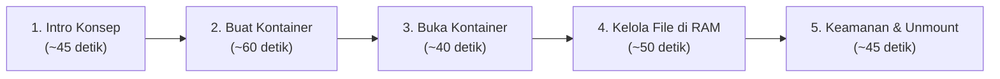

# PANDUAN REKAMAN & NASKAH DEMO STEGOVAULT

> [!TIP]
> **Petunjuk Perekaman Mandiri:**
> * **Aplikasi Perekam:** OBS Studio, Loom, atau Game Bar (Windows + G).
> * **Persiapan Awal:** 
>   1. Jalankan `npm run dev` di terminal, lalu buka `http://localhost:5173/` di peramban (Chrome / Edge).
>   2. Atur zoom peramban pada **100%** (atau 110% agar teks lebih terbaca jelas).
>   3. Siapkan file contoh untuk diunggah: [dataset.csv](file:///c:/Users/ADVAN/Documents/.0Semester5/Kriptografi%20dan%20Keamanan%20Data/StegoVault/demo-assets/dataset.csv).
> * **Target Durasi:** 3 sampai 4 menit dengan tempo bicara santai, natural, dan jelas.

---

## RANGKUMAN ALUR DEMONSTRASI

---

## SCENE 1: PEMBUKA & PENGENALAN KONSEP
* **Estimasi Waktu:** 00:00 - 00:45 (~45 detik)
* **Tampilan:** Halaman Beranda StegoVault (`http://localhost:5173/`)

### Panduan Aksi Layar:
1. Mulai rekaman dengan menampilkan halaman utama StegoVault secara penuh.
2. Arahkan kursor pelan-pelan ke logo StegoVault dan teks headline utama.
3. Gulir sedikit ke bawah untuk memperlihatkan 3 kartu fitur (PDF Cover, Client-Side, AES-256-GCM).
4. Kembali ke atas menuju tab **Buat Kontainer Baru**.

### Naskah Narasi (Gaya Santai & Mudah Dipahami):
> *"Halo semuanya! Pernah nggak kalian punya dokumen atau data penting yang ingin disimpan secara aman, tapi nggak ingin orang lain curiga?*
>
> *Biasanya orang mengunci file pakai format ZIP atau RAR yang diberi password. Tapi begitu orang lain melihat file itu di komputer, mereka langsung tahu kalau di dalamnya ada rahasia.*
>
> *Nah, kenalkan **StegoVault**. StegoVault adalah aplikasi brankas berkas digital berbasis web. Kerennya, seluruh file rahasia kita akan disimpan dan 'disembunyikan' di balik sebuah dokumen PDF biasa.*
>
> *Semua proses pengamanan ini berjalan seratus persen di dalam browser komputer kita sendiri tanpa pernah dikirim ke internet atau server mana pun. Jadi privasi kita benar-benar terjaga.*
>
> *Yuk, langsung saja kita coba cara pakainya!"*

---

## SCENE 2: MEMBUAT BRANKAS & MENGUMPULKAN ENTROPI MOUSE
* **Estimasi Waktu:** 00:45 - 01:45 (~60 detik)
* **Tampilan:** Modal **Buat Kontainer Baru** & Kanvas Entropi

### Panduan Aksi Layar:
1. Klik tab **Buat Kontainer Baru**, lalu klik tombol biru **Mulai Buat (.pdf)**.
2. Di kolom *Nama Volume Kontainer*, ketik: `brankas_rahasia`.
3. Di kolom *Kata Sandi*, ketik: `Kripto2026!Aman`.
4. Di kolom *Konfirmasi Kata Sandi*, ketik ulang: `Kripto2026!Aman`.
5. Tunjukkan indikator kekuatan sandi yang berubah hijau bertuliskan **Sangat Kuat (Maksimal)**.
6. Arahkan kursor ke area kotak hitam berbintang (**Pengumpul Entropi Fisik**), lalu gerak-gerakkan mouse memutar secara aktif sampai progress bar mencapai **100%**.
7. Klik tombol biru **Buat & Unduh Kontainer (.pdf)**.
8. Tunjukkan sekilas file PDF baru yang otomatis terunduh di browser.

### Naskah Narasi:
> *"Pertama, kita pilih menu Buat Kontainer Baru.*
>
> *Di sini kita tentukan nama brankasnya, misalnya 'brankas_rahasia'. Lalu kita masukkan kata sandi utama.*
>
> *Perhatikan indikator di bawahnya: sistem otomatis mendeteksi apakah sandi kita cukup aman dari tebakan orang lain. Kalau kombinasinya bagus, indikator akan berubah hijau menjadi 'Sangat Kuat'.*
>
> *Nah, ada satu fitur unik di sini, yaitu **Pengumpul Entropi Fisik**. Kita diminta menggerak-gerakkan kursor mouse di dalam kotak ini. Analoginya mirip seperti mengocok dadu sebelum melempar. Gerakan tangan kita yang acak ini dipakai sistem untuk menciptakan kunci pengacak yang murni dan mustahil ditebak oleh siapa pun.*
>
> *Setelah persentasenya mencapai seratus persen, tombol unduh langsung aktif. Kita klik 'Buat Kontainer', dan StegoVault akan langsung membuatkan file PDF resmi yang bisa kita simpan di komputer."*

---

## SCENE 3: MEMBUKA KEMBALI BRANKAS PDF
* **Estimasi Waktu:** 01:45 - 02:25 (~40 detik)
* **Tampilan:** Tab **Buka Kontainer (.pdf)** & Modal Mount Gate

### Panduan Aksi Layar:
1. Klik tab **Buka Kontainer (.pdf)** di halaman utama.
2. Tarik (*drag and drop*) file PDF yang baru saja diunduh ke area dropzone tengah (atau klik untuk memilih file).
3. Arahkan kursor ke tulisan badge hijau bertuliskan **Kontainer Valid**.
4. Masukkan password yang tadi dibuat: `Kripto2026!Aman`.
5. Klik tombol biru **Buka Berangkas**.

### Naskah Narasi:
> *"Sekarang mari kita buktikan. Kalau file PDF tadi dibuka di pembaca dokumen biasa seperti Adobe Acrobat atau Google Chrome, tampilannya hanyalah faktur tagihan (invoice) komersial resmi tanpa kecurigaan sedikit pun bahwa di dalamnya tersembunyi brankas rahasia.*
>
> *Tapi kalau kita bawa file PDF tersebut ke StegoVault di tab Buka Kontainer, sistem dengan sangat cerdas langsung mengenali bahwa di balik PDF ini ada brankas rahasia.*
>
> *Hebatnya lagi, sistem hanya butuh waktu sekejap mata untuk memvalidasi dokumen tanpa perlu memeriksa seluruh lembar dokumen satu per satu.*
>
> *Tinggal kita masukkan kata sandi utama yang kita buat tadi, klik 'Buka Berangkas', dan pintu brankas virtual kita langsung terbuka!"*

---

## SCENE 4: MENGELOLA FILE DI VIRTUAL DRIVE & PRATINJAU RAM
* **Estimasi Waktu:** 02:25 - 03:15 (~50 detik)
* **Tampilan:** Halaman **Virtual Drive** (Tabel Explorer)

### Panduan Aksi Layar:
1. Setelah brankas terbuka, perlihatkan tabel brankas virtual.
2. Klik tombol biru **+ Tambah Berkas** di kanan atas.
3. Pilih berkas payload contoh, misalnya `dataset.csv` (atau file dokumen/foto apa saja).
4. Tunjukkan file langsung muncul di baris tabel dengan ukuran dan tipenya.
5. Pada baris file `dataset.csv`, klik tombol mata (**Lihat pratinjau**).
6. Tunjukkan bahwa isi dokumen CSV langsung bisa dibaca di dalam jendela pop-up.
7. Klik tombol silang (**X**) untuk menutup pratinjau.

### Naskah Narasi:
> *"Nah, sekarang kita sudah berada di dalam ruang Virtual Drive kita sendiri.*
>
> *Di sini kita bebas menambah berkas pribadi apa saja. Sebagai contoh, saya mengunggah file data CSV ke dalam brankas.*
>
> *Keunggulan paling penting dari StegoVault adalah: **seluruh berkas ini hanya hidup di dalam memori RAM komputer kita**, bukan di hard disk.*
>
> *Kalau kita ingin melihat isinya, cukup klik tombol pratinjau. Berkas langsung terbuka di layar secara instan. Tidak ada file sementara atau cache yang tertinggal di komputer, sehingga tidak bisa dilacak oleh orang lain yang meminjam laptop kita.*
>
> *Begitu jendela pratinjau ditutup, tautan memorinya langsung dibersihkan seketika."*

---

## SCENE 5: METRIK KEAMANAN, PENUTUPAN, & ZERO-MEMORY
* **Estimasi Waktu:** 03:15 - 04:00 (~45 detik)
* **Tampilan:** Security Drawer & Tombol Simpan & Unmount

### Panduan Aksi Layar:
1. Klik tombol **Metrik Kripto** di pojok kanan atas navbar. Panel samping kanan akan terbuka.
2. Klik tab **Avalanche Lab**. Arahkan kursor ke matriks kotak-kotak bit SHA-256 yang berwarna-warni.
3. Tekan tombol **Escape** pada keyboard (atau klik tanda silang) untuk menutup panel.
4. Klik tombol merah **Simpan & Unmount** di kanan atas tabel.
5. Perlihatkan file PDF baru terunduh (versi ter-update) dan layar otomatis kembali ke Beranda awal.

### Naskah Narasi:
> *"Bagi yang penasaran seberapa kuat keamanannya, StegoVault menyediakan menu 'Metrik Kripto'.*
>
> *Di tab Avalanche Lab ini, kita bisa melihat bukti visual bahwa jika ada orang yang salah mengetik sandi meski hanya beda satu huruf atau satu tanda titik saja, hasil enkripsinya akan teracak total hingga lima puluh persen, membuat hacker mustahil menebak polanya.*
>
> *Terakhir, jika kita sudah selesai bekerja, kita cukup menekan tombol 'Simpan & Unmount'.*
>
> *Sistem akan membungkus kembali seluruh data ke dalam file PDF baru, lalu secara otomatis menjalankan fungsi pembersihan memori atau 'zero-memory' untuk menghapus bersih semua sisa data dari RAM.*
>
> *Semua data kita kini aman kembali di dalam dokumen PDF biasa tanpa meninggalkan jejak apa pun. Sekian demonstrasi StegoVault, terima kasih!"*

---

## CHECKLIST SEBELUM MEMULAI REKAMAN

* [ ] Dev server sudah aktif (`npm run dev`) di port `5173`.
* [ ] File `temp_vault.pdf` dan `dataset.csv` sudah ada dan mudah diakses dari folder komputer.
* [ ] Notifikasi peramban atau suara Windows sudah di-*mute* (Focus Assist / Do Not Disturb aktif).
* [ ] Kursor mouse digerakkan dengan tenang dan terarah (hindari gerakan terburu-buru).
